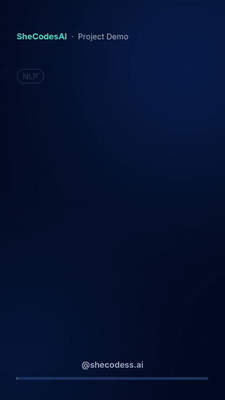
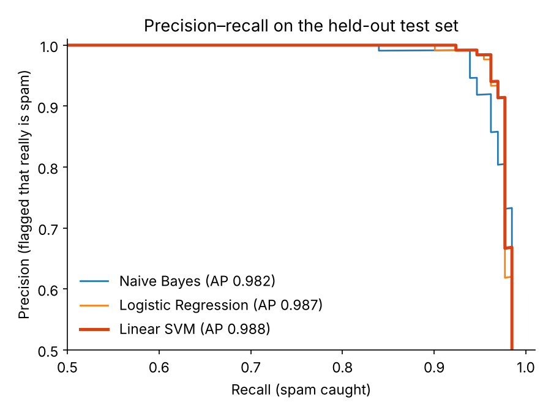
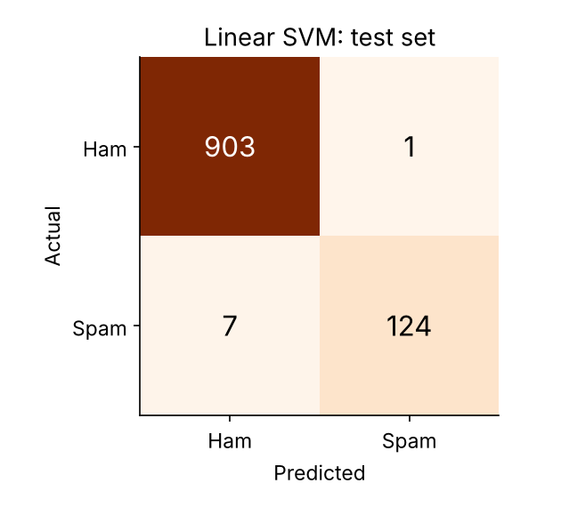
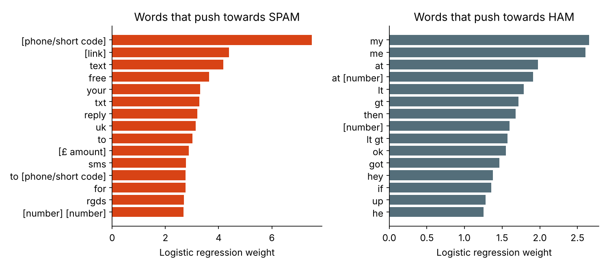

# SMS Spam Classifier

<p align="center"><a href="https://abbasisarah.github.io/assets/videos/demo-sms-spam-classifier.mp4"></a><br><sub>17-second demo. Click for the video with sound.</sub></p>

A text classifier that flags spam SMS messages. On held-out test messages it catches **94.7% of spam** and wrongly flags **1 genuine message in 868** (precision 99.2%, F1 0.969).



## Results

The data is the 5,574-message [SMS Spam Collection](https://archive.ics.uci.edu/dataset/228/sms+spam+collection). 403 messages are exact duplicates. If they are left in, the same message can end up in both the training and the test set, which inflates the scores, so they are removed first. That leaves **5,171 unique messages (653 spam)**, split 80/20 into training and test sets with the same spam rate in each.

| Model | Precision | Recall | F1 | PR-AUC | False alarms | Missed spam |
|---|---|---|---|---|---|---|
| Naive Bayes (word TF-IDF) | 97.6% | 93.9% | 0.957 | 0.982 | 3 | 8 |
| Logistic Regression (word + char TF-IDF) | 99.2% | 94.7% | 0.969 | 0.987 | 1 | 7 |
| **Linear SVM (word + char TF-IDF)** | **99.2%** | **94.7%** | **0.969** | **0.988** | **1** | **7** |

Test set: 1,035 messages (868 ham, 167 spam). The final model was chosen on 5-fold cross-validation F1 within the training set, before the test set was used. The Linear SVM won narrowly (CV F1 0.961 against 0.960 for logistic regression).

| | |
|---|---|
|  |  |

**What the model learned.** The strongest spam signals are phone numbers and short codes, links, "text", "free", "txt", "reply" and money amounts. Genuine messages are personal: "my", "me", "ok", "hey". The "lt gt" tokens come from `&lt;#&gt;` placeholders that the dataset's authors used to anonymise numbers in genuine messages.

**Where it fails.** Missed spam tends to be soft-sell advertising with no phone number, such as a club announcing ticket sales or a fast-food promotion. The single false alarm was a genuine message about a bill amount ("Your bill at 3 is £33.65…").

## How it works

1. **Normalise:** lower-case the text and replace links, long numbers (phone numbers and short codes), money amounts and other numbers with placeholder tokens. The model learns "contains a phone number" rather than memorising specific numbers.
2. **Features:** TF-IDF on word 1–2 grams plus character 3–5 grams. The character n-grams catch obfuscated spellings such as "fr33" or "w1n".
3. **Classifiers:** Multinomial Naive Bayes, class-balanced logistic regression, and a linear SVM with calibrated probabilities.
4. **Evaluation:** a stratified hold-out test set after deduplication, model selection by cross-validation only, and precision-recall reported alongside accuracy, because only 13% of messages are spam.

## Run it

```bash
pip install -r requirements.txt
python train.py                      # trains, evaluates, writes results/ and models/ (~10 s)
python predict.py "WINNER!! You have won a free £1000 prize. Call 09061701461 now"
python -m pytest tests               # quick checks
```

```
SPAM  100.0%  WINNER!! You have won a free £1000 prize. Call 09061701461 now
ham     0.3%  Hey, are we still meeting at 6 for dinner?
```

## Project structure

```
├── data/sms.tsv          SMS Spam Collection (label <tab> message)
├── src/spam.py           loading, deduplication, text normalisation, models
├── train.py              training, evaluation and figures
├── predict.py            classify your own messages
├── tests/                unit tests
└── results/              metrics.json and figures
```

## Data and licence

The SMS Spam Collection is by T. A. Almeida and J. M. Gómez Hidalgo (UCI Machine Learning Repository, CC BY 4.0). If you use it, cite: T. A. Almeida, J. M. G. Hidalgo, A. Yamakami, *Contributions to the Study of SMS Spam Filtering: New Collection and Results*, ACM DocEng 2011. The code is released under the MIT licence.
